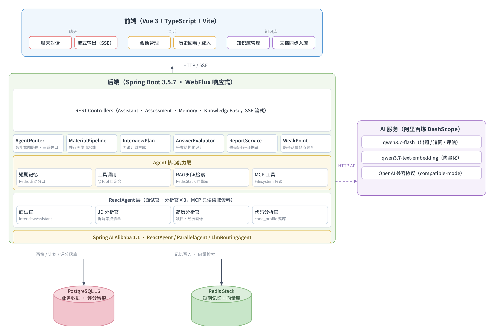
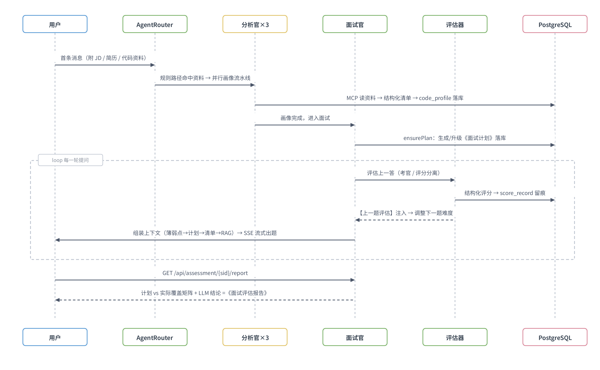
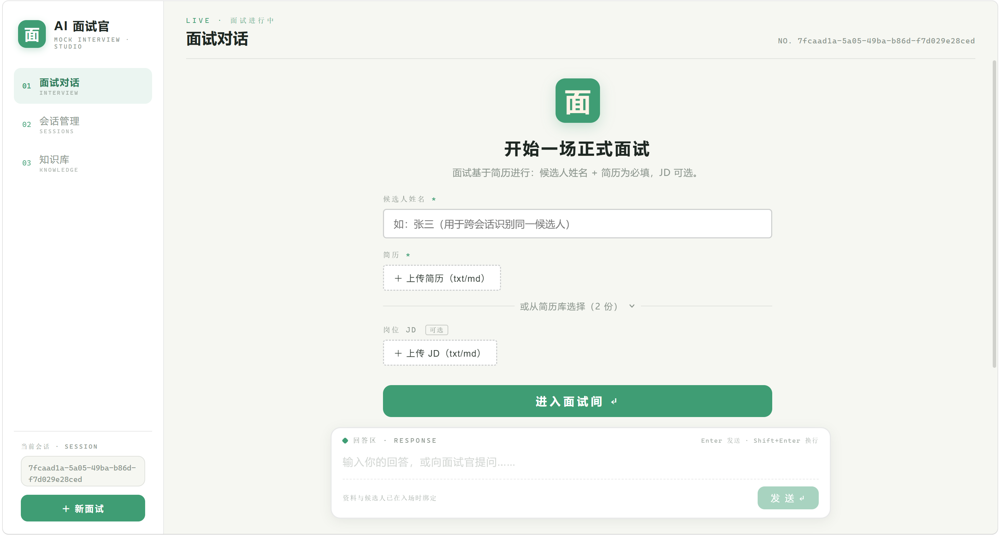
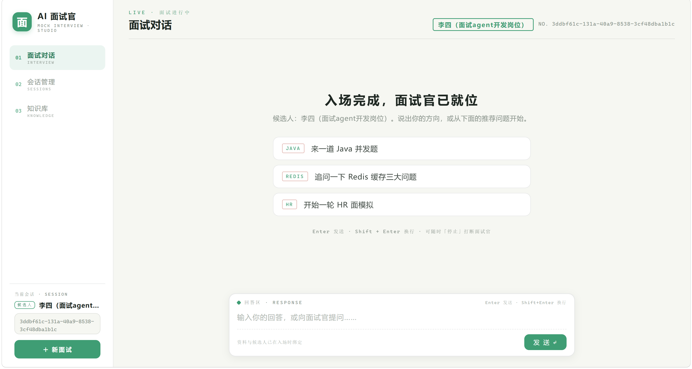
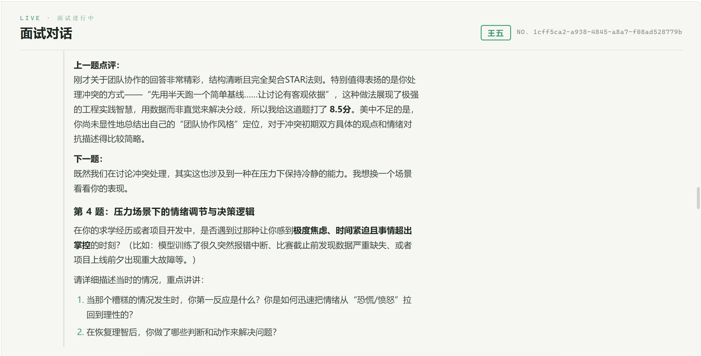
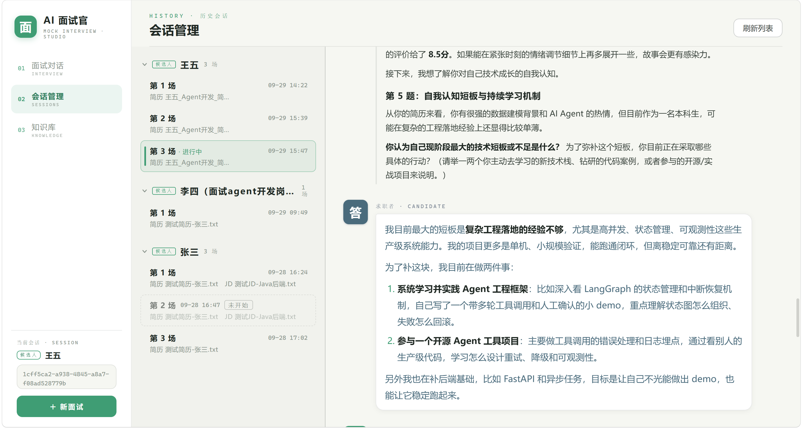
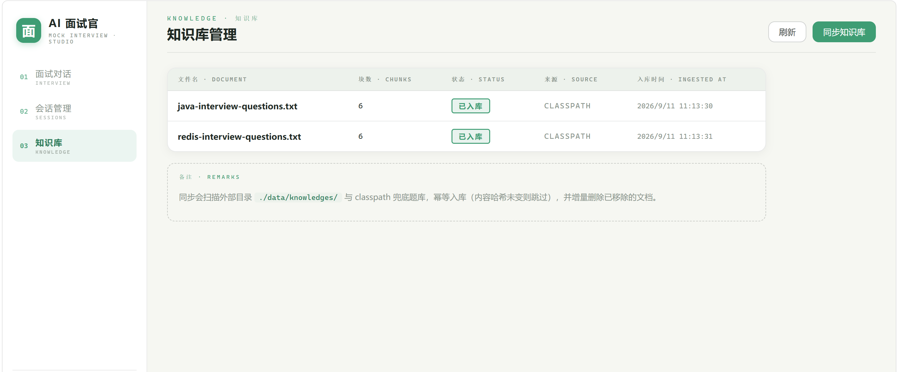

# AI Interviewer（AI 多 Agent 模拟面试官）

基于 **Spring AI Alibaba 1.1** 从 0 到 1 构建的多 Agent 能力评估系统：输入 JD / 简历 / 代码，多 Agent 并行画像，按《面试计划》实时自适应考核，输出**带证据链的《面试评估报告》**。

## 核心功能

- AI 模拟面试：ReactAgent 面试官按《面试计划》逐轮出题、追问、点评，SSE 流式输出
- 多资料画像：JD 分析官 / 简历分析官 / 代码分析官并行运行（MCP 只读读取本地资料），产出结构化清单落库，作为出题依据
- 智能意图路由：三道关口——复用快路径 → 资料规则路径 → 语义路由（LLM 二分类），省 token 且不误路由
- 会话内评估闭环：答案评估器（考官/评分分离）对每轮回答结构化评分，代码侧落库留痕，评估结果当场注入影响下一题难度
- 题库RAG：Redis Stack 向量库 + 文本 Embedding，面试官出题前检索知识库文档增强上下文
- 跨会话薄弱点回顾：候选人维度 SQL 聚合历史评分（精度高、零幻觉），开场注入或工具主动获取
- MCP工具生态：MCP Client 接入官方 Filesystem Server（只读过滤），支持"代码评审式面试"
- 会话与知识库管理：多会话管理、历史回看/载入/清空；知识库文档同步、分块、幂等入库

## 系统架构



> 前端三页面 → WebFlux 后端（路由 / 画像 / 面试官 / 评估闭环 / 核心能力层）→ 百炼模型服务，数据落 PostgreSQL 与 Redis Stack

## 核心流程（一次资料面试会话）



> 路由命中资料 → 分析官×3 并行画像落库 → 生成《面试计划》→ 每轮「评估上一答 → 调整难度 → 流式出题」闭环 → 输出《面试评估报告》

## 技术栈

### 后端

| 层           | 选型                                                                 |
| ----------- | ------------------------------------------------------------------ |
| 框架          | Spring Boot 3.5.7（WebFlux / Netty，SSE 流式）                          |
| AI 框架       | Spring AI 1.1.2 + Spring AI Alibaba 1.1.2.0                        |
| 模型接入        | 阿里百炼（DashScope OpenAI 兼容协议）：qwen3.7-flash / qwen3.7-text-embedding |
| 短期记忆 / 向量检索 | Redis Stack（滑动窗口记忆 + 向量库）                                          |
| 业务持久化       | PostgreSQL 16 + Spring Data JPA                                    |
| MCP         | MCP Client 接入官方 Filesystem Server（ReadOnlyMcpToolFilter 只读）        |
| Agent 模式    | ReactAgent（面试官 + 分析官×3）、ParallelAgent 并行画像、LlmRoutingAgent 意图路由    |

### 前端

| 维度   | 选型                                 | 说明                                |
| ---- | ---------------------------------- | --------------------------------- |
| 框架   | Vue 3（`<script setup>`）            | 响应式天然契合 SSE 流式聊天                  |
| 构建   | Vite                               | 开发态 proxy `/api` → 8080，免 CORS    |
| 语言   | TypeScript                         | 接口契约与后端一一对应                       |
| 状态管理 | Pinia                              | 按域拆分（chat / sessions / knowledge） |
| 路由   | Vue Router（hash 模式）                | 聊天 / 会话 / 知识库三页面                  |
| 流式解析 | 自写 SSE 解析器（fetch + ReadableStream） | POST 流式，支持打字机效果                   |
| 样式   | 自写轻量 CSS（CSS 变量）                   | 不引重型 UI 库，可控干净                    |

## 项目结构

```
├── src/main/java/com/xiao/aiagent/
│   ├── controller/        # Assistant（SSE 对话）/ Assessment（报告）/ Memory / KnowledgeBase
│   ├── services/          # AgentRouter 路由、流水线、面试官、3 个分析官、
│   │                      # 面试计划 / 答案评估 / 评估报告 / RAG 检索 / 薄弱点聚合
│   ├── config/            # Agent 装配、模型适配、知识库加载
│   ├── entity/            # CodeProfile / InterviewPlan / ScoreRecord / KnowledgeDocument
│   └── repository/        # Spring Data JPA
├── frontend/              # Vue 3 独立工程（Vite + TS + Pinia）
│   └── src/{api,stores,views,components,utils}
├── docs/                  # 前后端架构文档 + 分阶段开发计划（详细设计都在这里）
└── docker-compose.yml     # PostgreSQL / Redis Stack 本地依赖
```

## 快速开始

### 1. 启动依赖（PostgreSQL + Redis Stack）

```bash
docker compose up -d
```

### 2. 配置密钥

Key 的**唯一来源**是环境变量 `DASHSCOPE_API_KEY`，项目内不存在任何含密钥的配置文件。三种方式任选，**推荐方式一**（一次配好，终端和 IDEA 都生效）。

#### 方式一：Windows 用户环境变量（推荐）

```powershell
setx DASHSCOPE_API_KEY "sk-xxx"
```

- **生效范围**：之后新开的终端、`mvn spring-boot:run`、IDEA 里点启动，全都能读到
- **注意**：`setx` 写的是注册表，**不会灌进当前已经打开的窗口**。执行后必须**关掉终端/IDE 重开**，新进程才拿得到

#### 方式二：IDEA 启动配置（只对 IDEA 生效）

`Run/Debug Configurations` → 选中你的 Spring Boot 配置 → `Environment variables` 栏填一行：

```
DASHSCOPE_API_KEY=sk-xxx
```

- **好处**：立刻生效，不用重启 IDE，也不用改系统设置
- **代价**：只对 IDEA 生效——在终端敲 `mvn spring-boot:run` 时仍然是空值
- **安全性**：值存在 `.idea/workspace.xml`，已被 `.gitignore` 忽略，不会进 git

> API Key 获取：[阿里云百炼控制台](https://bailian.console.aliyun.com/)。项目必须走 OpenAI 兼容端点（`compatible-mode`），配置中已固定。
>
> **环境变量没设会怎样**：应用能正常启动（占位符取空串不会报错），但第一次调用 LLM 时会返回 `401 InvalidApiKey`。遇到这个错先确认变量是否真的生效：
>
> ```bash
> echo $env:DASHSCOPE_API_KEY    # PowerShell；IDEA 方式要在 IDEA 的终端里查
> ```
>
> 输出为空说明当前进程没拿到——回到上面检查一下是不是漏了"重开窗口"这一步。

### 3. 启动后端

```bash
mvn spring-boot:run           # 默认端口 8080（需本机已装 Maven）
```

### 4. 启动前端

```bash
cd frontend
npm install
npm run dev                   # http://localhost:5173，/api 已代理到 8080
```

### 5. 生产态部署（可选）

```bash
cd frontend && npm run build
# 将 dist/* 拷贝到 src/main/resources/static/，由 Spring Boot 同源托管
# 访问 http://localhost:8080/ 即前端，/api/* 同源无跨域
```

## 安全说明

- 仓库内不含任何真实密钥：`application.properties` 只留 `${DASHSCOPE_API_KEY:}` 占位符，Key 由环境变量注入；项目内没有任何存放密钥的文件（`.gitignore` 通配兜底 `application-*local*.properties`）
- `git ls-files` 可验证名录干净，`git log -p` 全历史只有占位符；git 历史经过 filter-branch 清洗，不含历史遗留密钥
- MCP Filesystem 根目录收窄到 `${user.dir}/data`，LLM 读不到 `src/` 源码和任何配置文件（曾经的隐性泄露通道）
- `data/`（外部知识库）、`test-http/`、`.verify-payloads/` 等本地调试产物均不入库

## 效果演示

<p align="center">
  
  <br/>
  <sub><b>模拟面试入口</b>：选择面试模式、方向与难度，快速开始</sub>
</p>

<p align="center">
  
  <br/>
  <sub><b>面试入场</b>：候选人姓名 + 简历必传、JD 可选，资料分析后自动生成面试计划</sub>
</p>

<p align="center">
  
  <br/>
  <sub><b>面试对话与点评</b>：流式追问、单题评估、答后点评</sub>
</p>

<p align="center">
  
  <br/>
  <sub><b>会话管理</b>：按候选人分组，薄弱点跨会话累积</sub>
</p>

<p align="center">
  
  <br/>
  <sub><b>知识库管理</b>：题库文档向量化入库，出题检索的基础</sub>
</p>
